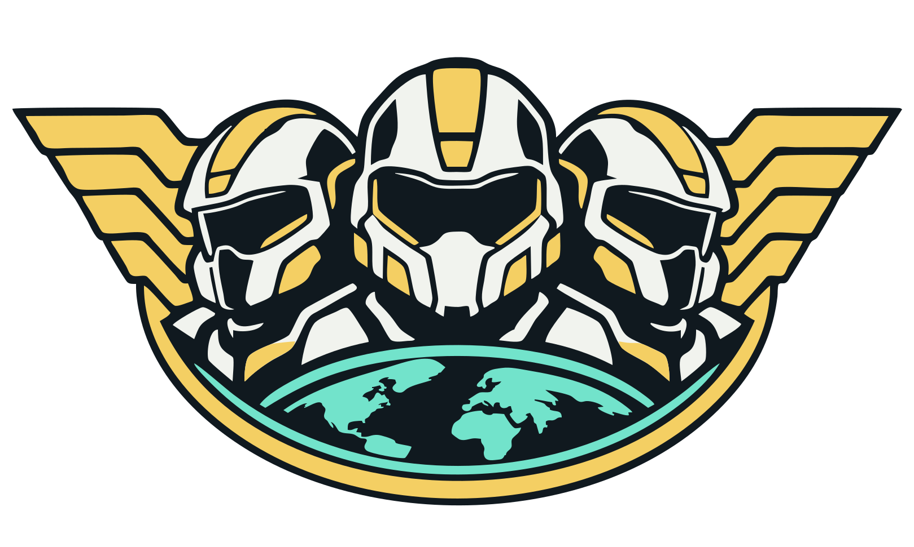
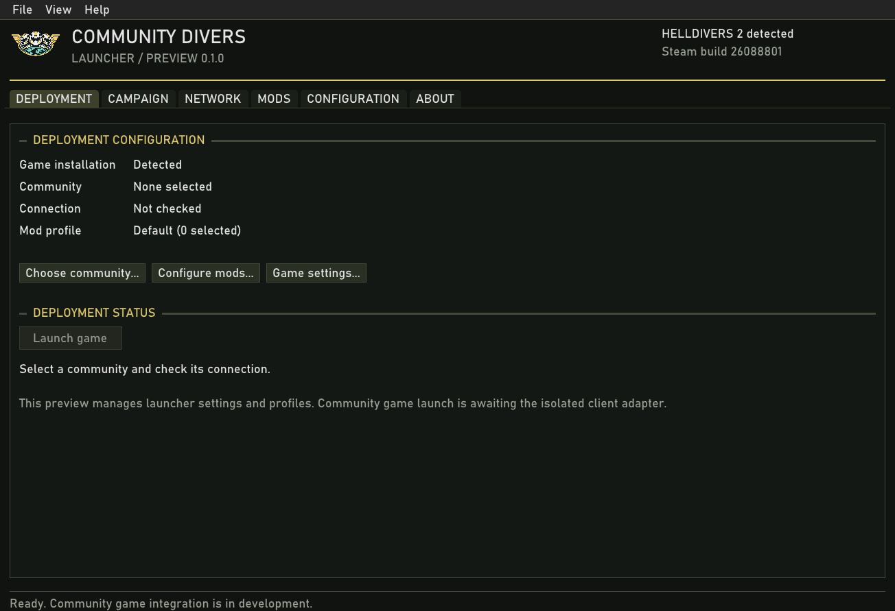

<div align="center">



**Your community. Your campaign.**

A native C++ launcher and self-hosted campaign platform for community-run
HELLDIVERS 2 wars.

</div>

> **Launcher preview.** Installation discovery, saved connections, mod profiles
> and a persistent community service are available. Game integration and community
> co-op are under development. This preview cannot launch a community game session.

Community Divers is being built for players who want to share a persistent war,
run their own progression and choose their mods together. Each community can
operate its own campaign service, while players' machines run individual missions
using their own installed game assets.

The launcher uses a HELLDIVERS 2-inspired menu layout and is written in C++20
with Win32, Direct3D 11 and Dear ImGui. The portable core is
kept separate from Windows integration. It does not require a webview, Python or
.NET to run.



## Launcher preview

[Download a Windows preview](https://github.com/Nnamllit1/community-divers/releases)
and verify it with the accompanying SHA-256 file.

- Detect an existing game through Steam or choose its installation directory.
- Save community HTTPS endpoints and check their protocol/build advertisements.
- Inspect local mod manifests and save selections in named profiles.
- Recover settings without silently discarding a malformed original file.
- Export read-only client fingerprints for exact-build integration analysis.
- Prepare and verify an independent game-file copy using installed Steam depot inventories.
- Display a connected community service's persisted campaign and mission templates.
- Import community player credentials, remember sign-in securely and read live progression.

Current builds check a signed preview feed and stage verified downloads. Portable
packages support Install and restart with startup checks, rollback and interrupted
update recovery. `Update.cmd` performs the native update handoff without entering
the UI. The original `v0.1.0-preview.1` predates these features and needs a manual
replacement. In-app installation scheduling and server updates remain planned.

Run `out/windows-dev/CommunityDivers.exe` after building, or use the executable
in a portable package. Launcher data lives in `%LOCALAPPDATA%/CommunityDivers`.
A server connection does not establish game-client compatibility. Launch remains
unavailable until the isolated current-client adapter has been implemented.

See [service status](docs/service-contract.md) and
[mod manifests](docs/mod-manifests.md) for the current contracts.
[Client inspection](docs/client-integration.md) describes the build catalog and
unimplemented game-adapter gates.

## Community service

The native C++ service persists independent community profiles, loadouts, configured
planets/templates and mission results in SQLite. Operator credentials control
campaign configuration; player credentials scope profile changes. Result receipts
are deduplicated transactionally, and backups/restores use verified snapshots.
The service binds to loopback behind an operator-managed HTTPS proxy.

See [self-hosting](docs/self-hosting.md) and [the service contract](docs/service-contract.md).
See [player profiles](docs/player-profiles.md) for launcher sign-in.
The game adapter, lobby transport and scheduling/voting remain in development. API mission results are not native gameplay verification.

## Development

Most of this project's code and artwork is AI-generated. Review and validation
are ongoing. The launcher also includes this disclosure in About.

Requirements: CMake 3.25+, a C++20 compiler, and the Windows SDK for the launcher.
Dependencies are downloaded from pinned releases at configure time.

On Windows, open a Visual Studio x64 developer terminal:

```console
cmake --preset windows-dev
cmake --build --preset windows-dev
ctest --preset windows-dev
```

`Build.cmd` finds the installed Visual Studio tools and runs the same steps.
Dependencies are pinned by version and archive SHA-256.
See [validation](docs/testing.md) for core, native HTTP and offscreen widget checks.

To prepare a portable directory:

```console
cmake --install out/windows-dev --prefix dist/CommunityDivers
```

To produce a versioned ZIP and SHA-256 file:

```console
cpack --config out/windows-dev/CPackConfig.cmake -B dist
```

Packages include `build-info.json` with the exact source revision and release ID.
The [update documentation](docs/updates.md) covers signed preview checks and verified
downloads, plus planned CI publication, client/server release-set checks and rollback.

For the portable core on Linux:

```console
cmake --preset linux-dev
cmake --build --preset linux-dev
ctest --preset linux-dev
```

See [PROJECT.md](PROJECT.md) for the editable roadmap and acceptance criteria,
[architecture](docs/architecture.md) for component boundaries, and
[CONTRIBUTING.md](CONTRIBUTING.md) to contribute.

## Scope

- Community-operated war campaigns and independent player progression.
- A native launcher, installation discovery, server selection and mod profiles.
- Isolated current-client integration and community multiplayer.
- HTTPS services and multiplayer transport without player-side port forwarding.

No game assets or proprietary game binaries are included. A genuine owned game
copy is required. Modified gameplay and private progression stay separate from
official services. Nothing in this repository establishes current-game patch
compatibility or official approval.

Community Divers is an independent fan project, not affiliated with or endorsed
by Arrowhead Game Studios or Sony Interactive Entertainment.

## License

Project code is [MIT licensed](LICENSE). Third-party components retain their own
licenses; see [THIRD_PARTY.md](THIRD_PARTY.md).
